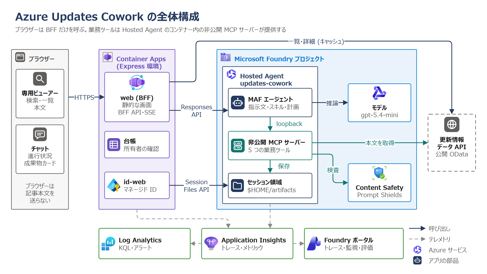

<h1 align="center">Azure Updates Cowork</h1>

<p align="center">
  Azure の更新情報を要約し、Word・PowerPoint を作成するエージェントを題材に、Microsoft Foundry Hosted Agent の構築から、テレメトリと評価基盤の整備・活用、評価結果に基づく継続的な改善までを学ぶサンプルコードです。
</p>

<p align="center">
  <a href="global.json"></a>
  <a href="docs/design.md"></a>
  <a href="docs/notes/observability.md"></a>
  <a href="LICENSE"></a>
</p>

<p align="center">
  <a href="https://tokawa-ms.github.io/azure-updates-cowork-starter-demo/">学習ガイド: 構成、Foundry 評価、Hosted Agent の統合と改善</a>
</p>

<p align="center">
  日本語 (プライマリ) · <a href="README-en.md">English</a>
</p>

<p align="center">
  <a href="#ローカルで試す">クイックスタート</a> ·
  <a href="docs/design.md">設計書</a> ·
  <a href="docs/notes/evaluation.md">評価と検証結果</a> ·
  <a href="#ドキュメント">ドキュメント一覧</a>
</p>

---

Azure の更新情報の専用ビューアーとチャットを並べ、Microsoft Agent Framework のエージェントに要約や資料作成を依頼できます。.NET 10、静的 HTML/CSS/JavaScript、Microsoft Foundry Hosted Agent を使います。サイト全体のリバースプロキシや iframe は使いません。

## 主な機能

| 機能                  | できること                                                        |
| --------------------- | ----------------------------------------------------------------- |
| 更新の検索・要約      | 更新を検索・選択し、公式URLを出典とした要約や関連更新の比較を依頼 |
| Word・PowerPoint 作成 | 同じ会話で資料を作成し、チャット内の成果物カードからダウンロード  |
| トレースと品質評価    | WebからMCP・Office生成までを追跡し、別Agentと固定30件で品質を検査 |

## 構成と利用上の注意



処理の流れ、ID とロール、多層の防御、観測、評価、配置の図は[構成図とフロー図](docs/diagrams/README.md)にまとめています。

5つの業務ツールは Agent コンテナー内の非公開 MCP サーバーが提供します。既存の開発環境で、専用ビューアーと資料作成までの動作を確認しています。学習用の少量利用を前提としたサンプルであり、本番運用の完成形ではありません。[設計書](docs/design.md)と[デプロイ記録](docs/notes/deploy.md)に構成と制約を記載しています。

> [!IMPORTANT]
> 機密情報は入力しないでください。自作Agentの本番本文記録は無効ですが、共有Foundryの`responsesapi`側には本番の入出力本文が記録されることを確認しています。アプリ側のスイッチとは別の設定であり、共有環境の設定変更は行っていません。

> [!NOTE]
> ローカル起動でもモデル呼び出しはAzureへ接続し、料金が発生します。固定データの指定は更新データだけを切り替えるもので、モデル呼び出しをオフラインにはしません。

<details>
<summary>成果物の保存・セッションの保持について</summary>

成果物は Hosted Agent の `$HOME/artifacts` に一時保存し、Web が所有者を確認して Session Files API で取得します。Blob の公開ダウンロードは不要です。新しい会話への切り替えで旧セッションを削除し、タブ終了時にも削除を試みます。終了要求が届かなければ最大30日残る場合があります。Web は1レプリカで、再起動すると台帳とセッション識別用のキーが失われます。

HTTP/MCP、Office生成、ファイル保存までのトレースを記録します。固定データ評価には本番とは別の `updates-cowork-eval` を使います。

</details>

## ローカルで試す

### 前提条件

| 必要なもの                        | 用途                                                |
| --------------------------------- | --------------------------------------------------- |
| .NET 10 SDK                       | ビルドとローカル実行                                |
| Azure CLI                         | プロジェクトを呼ぶ権限のあるアカウントで `az login` |
| 既存のFoundryプロジェクトとモデル | 関数呼び出しに対応したモデルデプロイ                |
| Docker (任意)                     | Aspire Dashboardの起動                              |

### 起動の準備

リポジトリのルートで実行します。

```powershell
dotnet dev-certs https --trust
dotnet build
docker compose -p auc-otel -f tools\otel\compose.yaml up -d
```

### ターミナル1: エージェント

`<account>`、`<project>`、`<deployment>` は既存環境の値に置き換えます。これはリソースを作成する手順ではありません。

```powershell
$env:FOUNDRY_PROJECT_ENDPOINT = 'https://<account>.services.ai.azure.com/api/projects/<project>'
$env:AZURE_AI_MODEL_DEPLOYMENT_NAME = '<deployment>'
$env:AZURE_TOKEN_CREDENTIALS = 'AzureCliCredential'
$env:ARTIFACTS_MODE = 'Local'
$env:ARTIFACTS_LOCAL_DIR = Join-Path $PWD '.artifacts'
$env:AZURE_UPDATES_FIXTURES_DIR = Join-Path $PWD 'eval\fixtures\updates'
$env:PROMPT_SHIELDS_MODE = 'Off'
$env:OTEL_EXPORTER_OTLP_ENDPOINT = 'http://localhost:4317'
dotnet run --project src\UpdatesCowork.Agent
```

`http://localhost:8088/readiness` が 200 を返すことを確認します。`AZURE_UPDATES_FIXTURES_DIR` は更新データだけを固定データに切り替えます。**モデル呼び出しは Azure に接続し、利用料金が発生します。** ローカルでは `FOUNDRY_AGENT_NAME` を設定しないでください。

既にこのリポジトリの `azd` 環境がある場合は、設定例の代わりに `. .\tools\env\load-env.ps1` でローカル用設定を読み込めます。Prompt Shields の `Off` はローカル学習用です。

### ターミナル2: 画面とBFF

```powershell
$env:Artifacts__LocalDir = Join-Path $PWD '.artifacts'
$env:AZURE_UPDATES_FIXTURES_DIR = Join-Path $PWD 'eval\fixtures\updates'
$env:OTEL_EXPORTER_OTLP_ENDPOINT = 'http://localhost:4317'
dotnet run --project src\UpdatesCowork.Web
```

`https://localhost:7101` を開き、左の一覧で更新を選びます。「要約」の後、同じ会話で「今要約した更新のWordを作って」「同じ更新のPowerPointを作って」と依頼できます。成果物はチャット内のカードからダウンロードします。別のブラウザーセッションの成果物は取得できません。

Aspire Dashboard は `http://localhost:18888` です。`execute_tool` → `POST /mcp/` → `tools/call` → `mcp.tool.execute` → `office.word.build` / `artifact.save` の親子関係を確認できます。ブラウザーからモデルへ記事本文は送りません。選択した ID・タイトル・公式 URL を渡し、エージェントが MCP ツールで本文を取得します。

実際の更新データを使う場合は、Web と Agent の両方で `AZURE_UPDATES_FIXTURES_DIR` を外します。`UpdatesCowork.SiteProxy` は旧構成の比較用として残していますが、現在の起動・デプロイには不要です。

## 停止と再開

ローカルの2つのターミナルでそれぞれ `Ctrl+C` を押します。再開は同じ起動コマンドです。Dashboard は次で停止します。共有環境では、ほかの利用者が使っていないことを確認してください。

```powershell
docker compose -p auc-otel -f tools\otel\compose.yaml stop
# 再開
docker compose -p auc-otel -f tools\otel\compose.yaml start
```

Azure のコンピュート停止・再開の手順は未検証です。`azd down` は一時停止ではなくリソース削除です。共有の Foundry アカウント、プロジェクト、モデルに対して実行しないでください。旧 proxy と Storage は、利用者の承認を受けて2026-11-13に削除しました。現行のWeb、Agent、ACR、ログなどの費用は引き続き発生し得ます。

## ビルドと単体テスト

```powershell
dotnet build --configuration Release
dotnet test --no-build --configuration Release --filter 'Category!=Eval'
.\eval\tests\run-foundry.tests.ps1
```

通常のテストはネットワークに接続しません。評価プロジェクトは評価データ・応答変換・判定ロジックを、PowerShellのテストはCLIの限定再試行をオフラインで検証します。モデルを呼ぶクラウド評価とは別です。

## 固定データで Foundry 評価を実行する

評価用 Agent のデプロイと権限設定を終えてから、Azure CLI にサインインした PowerShell 7 で実行します。対象は `-eval` で終わる Agent の明示した版だけです。

```powershell
.\eval\run-foundry.ps1 `
  -ProjectEndpoint 'https://<account>.services.ai.azure.com/api/projects/<project>' `
  -AgentVersion '<評価用Agentの版>' -Limit 30 -Out eval\out\core
```

30件は要約、Word、PowerPoint、検索・比較、未選択、対象外、間接プロンプトインジェクションを含みます。実際の Hosted Agent 応答を保存して Foundry の3評価器へ渡し、さらにツール使用、出典、日本語、Officeファイル、攻撃への抵抗をローカルで検査します。モデルと判定モデルの料金が発生します。

`eval\out\core` に `summary.md`、`summary.json`、`report.html`、Foundry のレポート URL が残ります。中断後は同じ引数に `-Resume` を付け、保存済み応答を再利用します。`check`の終了コードは合格0、不合格1、処理不正2です。PowerShellの通信・ビルド失敗も非ゼロで終了します。[評価の仕組みと結果](docs/notes/evaluation.md)に詳細を記載しています。継続評価や本番全トラフィックの自動採点は有効にしていません。

<details>
<summary>固定30件の検証結果（2026-11-13）</summary>

評価用Agent v12で、全8指標の品質ゲートを達成しました。指示遵守は29/30、出典は30/30です。ページ情報が採点入力から落ちる問題、対象確認とスキル開始の競合、検索・出典の漏れ、攻撃検出通知を修正しました。データセット・モデル・合格率の基準は変えず、出典などの検査は強化しています。品質改善は本番Agent v11にも反映し、ページ未選択時に更新取得を始めないことをスモークテストで確認しました。共有基盤とWebも同日に最新の定義・ソースへ更新しています。評価は固定30件に限られ、未見入力の品質までは保証しません。

</details>

## Azure と公開について

`azure.yaml` と `infra` には既存 Foundry 参照／新規作成の分岐があります。開発では必ず `EXISTING_AI_PROJECT_RESOURCE_ID`、`EXISTING_APPINSIGHTS_RESOURCE_ID`、既存のモデルデプロイ名を設定します。設定を省略すると新しい Foundry とモデルが作成対象になります。詳しくは[調査記録](docs/notes/deploy.md)を参照してください。

Deploy to Azure ボタンはまだ掲載していません。公開リポジトリURLが未確定であり、ARM による基盤作成だけではアプリのビルド・Hosted Agent 展開まで完了しないためです。動作しないリンクを完成済みとして案内しません。

公開前に更新サイトとデータAPIの利用条件を確認し、IP制限、認証、運用手順を整えてください。鍵やトークンを設定ファイルに書かず、`.azure`、`.artifacts`、会話録画はコミットしないでください。

## ドキュメント

| 資料                                                    | 内容                                                                      |
| ------------------------------------------------------- | ------------------------------------------------------------------------- |
| [設計書](docs/design.md)                                | アーキテクチャと契約                                                      |
| [構成図とフロー図](docs/diagrams/README.md)             | 全体構成、処理の流れ、セキュリティ、観測、評価、配置の図 (draw.io と PNG) |
| [実装計画](docs/implementation-plan.md)                 | P0〜P9の受け入れ条件                                                      |
| [サイト調査](docs/notes/site-survey.md)                 | データAPIの中継が必要な理由                                               |
| [ローカル統合と観測](docs/notes/local-integration.md)   | API、生成資料、会話、トレースの確認結果                                   |
| [MCPと観測](docs/notes/observability.md)                | トレースの親子関係、確認手順、本文記録の範囲                              |
| [固定データ評価](docs/notes/evaluation.md)              | 実応答の収集、Foundryでの採点、品質ゲート                                 |
| [デプロイ調査](docs/notes/deploy.md)                    | Azureの展開結果、Q番号、残る制約                                          |
| [事前検証](preflight-report.md)                         | Bicepと初回what-ifの結果                                                  |
| [公開前の情報確認](docs/notes/public-release-review.md) | 匿名化した情報、履歴の残存情報、公開前の判断                              |

学習ガイドは `site/` の Markdown を Jekyll でビルドし、GitHub Actions から GitHub Pages へ公開します。初回公開前に、リポジトリの **Settings → Pages → Build and deployment → Source** を **GitHub Actions** に設定してください。公開後の URL は `https://tokawa-ms.github.io/azure-updates-cowork-starter-demo/` です。

## ライセンス

このサンプルのコードとドキュメントは[MIT License](LICENSE)です。Copyright (c) 2026 tokawa-ms。
同梱するDOMPurifyとmarkedにはそれぞれのライセンスが適用されます。`src/UpdatesCowork.Web/wwwroot/lib/`配下のライセンス表記を保持してください。Azureの更新記事・製品名など第三者のコンテンツの権利は各権利者に帰属し、本リポジトリのMIT Licenseで再許諾するものではありません。
