# Architecture and flow diagrams

[日本語 (primary)](README.md) | English

These diagrams describe the architecture and processing flows of Azure Updates Cowork with Azure icons. They are sized so that you can paste them into slides or documents when you present or review the sample. Their content follows the [design](../design-en.md), the Bicep files in `infra/`, the code in `src/`, and the findings in [MCP and observability](../notes/observability-en.md).

## Files

Each diagram has an editable `.drawio` file and exported PNG images.

| File | Contents |
|---|---|
| `<number>-<name>.drawio` | draw.io source. Page 1 is Japanese, page 2 is English |
| `<number>-<name>.png` | Japanese image (2560×1440, 16:9) |
| `<number>-<name>-en.png` | English image (2560×1440, 16:9) |

All text is at least 16 px, which is 12 pt or larger when an image fills the width of a 16:9 slide.

| No. | Diagram | Typical use |
|---|---|---|
| 01 | Architecture overview | Show the whole system first |
| 02 | Screen layout and how the selected update reaches the agent | Explain the UI and why article text is not sent to the model |
| 03 | One chat turn | Explain the call order across the BFF, Hosted Agent, and MCP |
| 04 | Generated files: save, download, clean up | Explain where files live and how ownership is checked |
| 05 | Five building blocks of a Cowork-style agent | Explain how the agent is assembled |
| 06 | Inside the Hosted Agent: the private MCP boundary | Explain the container internals and the tool boundary |
| 07 | Identities and roles | Explain keyless access and role assignments |
| 08 | Defense in depth | Explain what each layer stops |
| 09 | Trace hierarchy and where to look | Explain how to inspect telemetry |
| 10 | Fixed-data evaluation pipeline | Explain the evaluation flow and quality gates |
| 11 | Deploying with azd and Bicep | Explain the deployed resources and steps |

## 01 Architecture overview

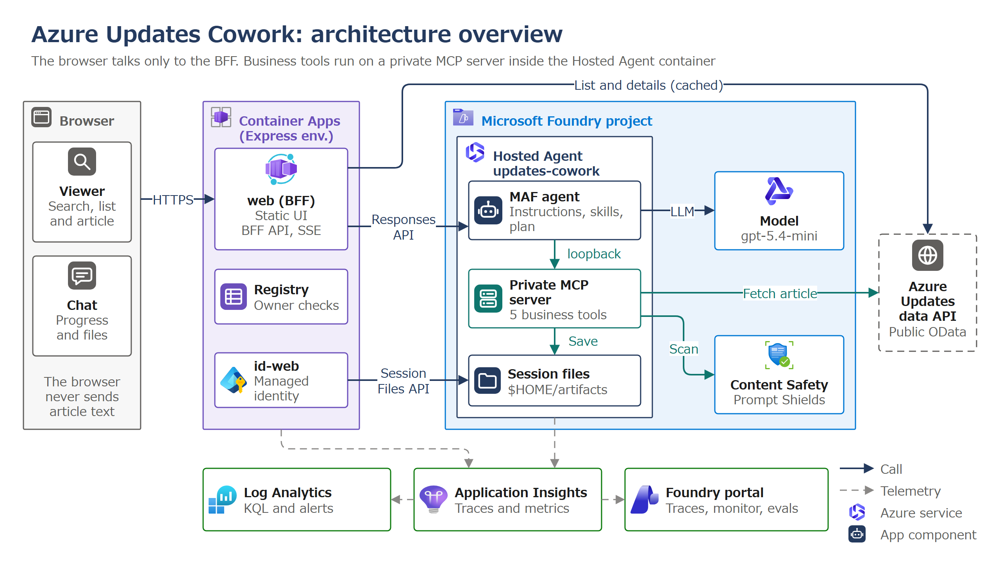

Shows how the browser, the web BFF on Container Apps, the Hosted Agent in Microsoft Foundry, the Azure Updates data API, and monitoring fit together. The browser calls only the BFF, and the BFF calls the Hosted Agent with a managed identity. Business tools run on a private MCP server inside the Hosted Agent container, and generated files are saved in the session file area.

Source: [01-architecture-overview.drawio](01-architecture-overview.drawio), Japanese: [01-architecture-overview.png](01-architecture-overview.png)

## 02 Screen layout and the selected update

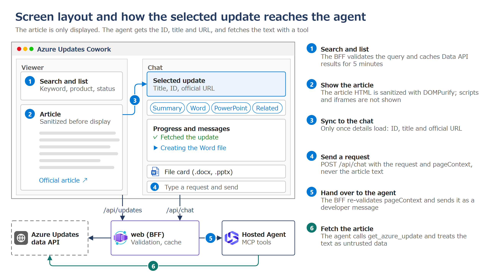

Shows the viewer on the left, the chat on the right, and the six steps that bring a selected update to the agent. The article is sanitized with DOMPurify and only displayed; the agent receives the ID, title, and official URL. The agent fetches the text itself with `get_azure_update` and treats it as untrusted data.

Source: [02-screen-and-context.drawio](02-screen-and-context.drawio), Japanese: [02-screen-and-context.png](02-screen-and-context.png)

## 03 One chat turn (creating a Word report)

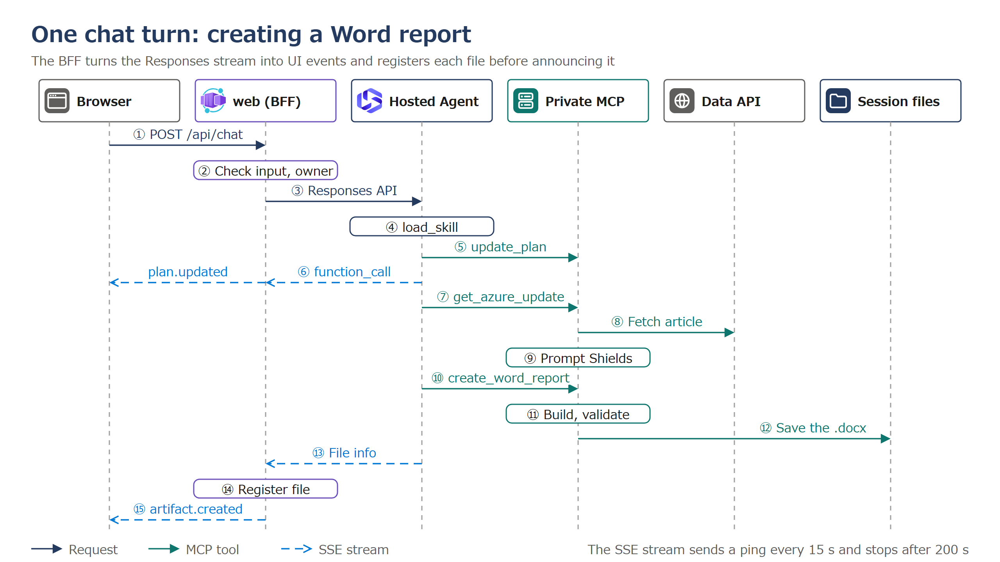

A sequence diagram of a Word request. The BFF checks the input and the owner before calling the Responses API, and the agent runs `load_skill`, `update_plan`, `get_azure_update`, and `create_word_report` in that order. Progress (`plan.updated`) reaches the screen while the work continues, and each file is registered before `artifact.created` is sent.

Source: [03-chat-turn-sequence.drawio](03-chat-turn-sequence.drawio), Japanese: [03-chat-turn-sequence.png](03-chat-turn-sequence.png)

## 04 Generated files: save, download, clean up

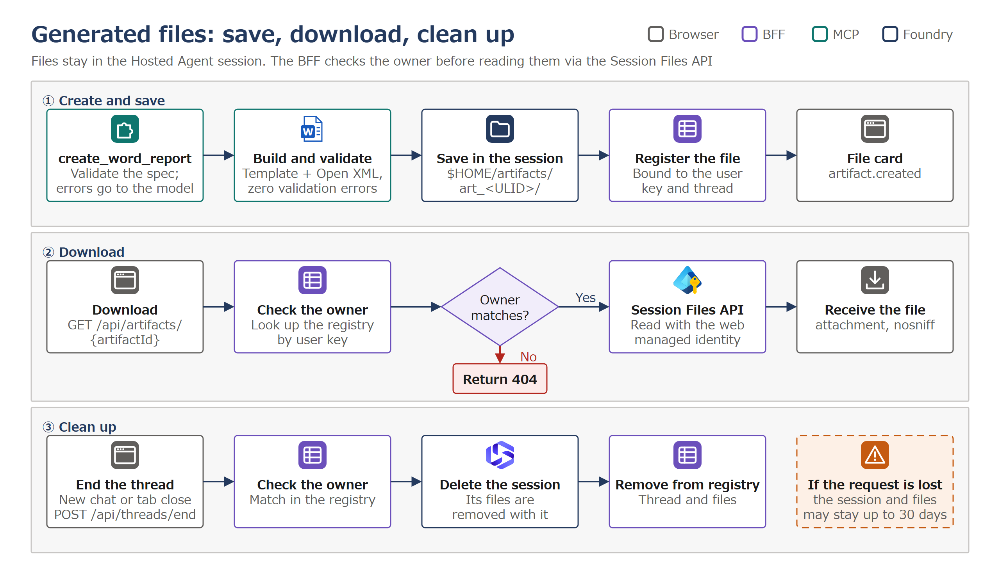

Three rows show where Word and PowerPoint files are stored, how they are retrieved, and when they are removed. For a download, the BFF checks the owner in its registry and reads only the owner's files through the Session Files API. Ending a conversation deletes the session; if that request never arrives, the files can remain for up to 30 days.

Source: [04-artifact-lifecycle.drawio](04-artifact-lifecycle.drawio), Japanese: [04-artifact-lifecycle.png](04-artifact-lifecycle.png)

## 05 Five building blocks of a Cowork-style agent

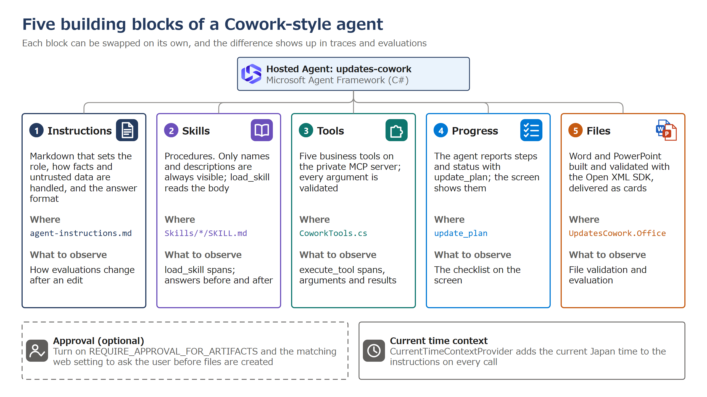

Summarizes the instructions, skills, tools, progress reporting, and generated files that make up the agent, with where each one lives and what to observe while learning. The optional approval feature and the context provider that adds the current time are also shown.

Source: [05-agent-building-blocks.drawio](05-agent-building-blocks.drawio), Japanese: [05-agent-building-blocks.png](05-agent-building-blocks.png)

## 06 Inside the Hosted Agent: the private MCP boundary

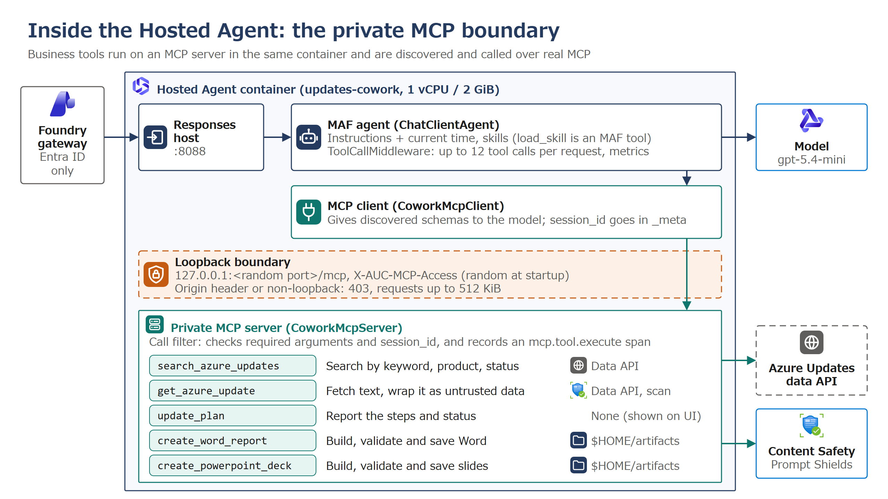

Shows how the Responses host, the MAF agent, the MCP client, and the private MCP server connect inside the Hosted Agent container. The MCP server listens on a random port on 127.0.0.1 and checks a per-start random header, the `Origin` header, the caller address, and the request size. The lower half of the diagram lists the five business tools and what each one reaches.

Source: [06-agent-mcp-internals.drawio](06-agent-mcp-internals.drawio), Japanese: [06-agent-mcp-internals.png](06-agent-mcp-internals.png)

## 07 Identities and roles

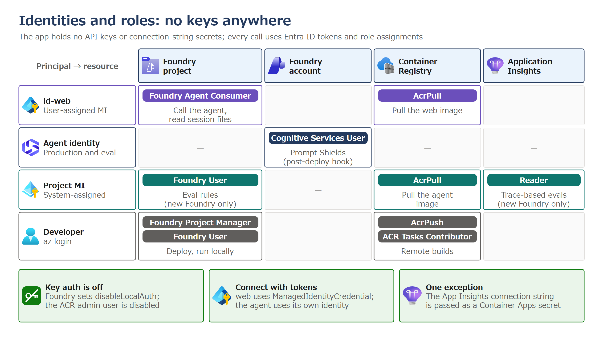

A table of which identity holds which role on which resource. Only assignments made by Bicep and the post-deploy hook are included. The project managed identity receives Foundry User and Reader only when the deployment creates a new Foundry.

Source: [07-identity-and-roles.drawio](07-identity-and-roles.drawio), Japanese: [07-identity-and-roles.png](07-identity-and-roles.png)

## 08 Defense in depth

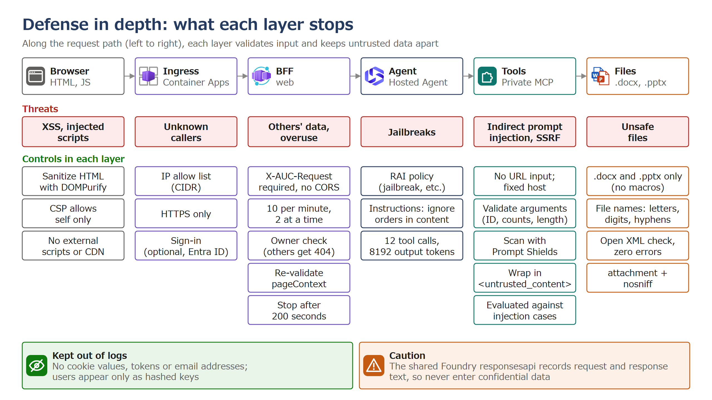

Following the request path, six layers (browser, ingress, BFF, agent, tools, and files) list the threats they address and the controls in place. The diagram also notes what is kept out of logs and that the shared Foundry layer records message text.

Source: [08-security-controls.drawio](08-security-controls.drawio), Japanese: [08-security-controls.png](08-security-controls.png)

## 09 Trace hierarchy and where to look

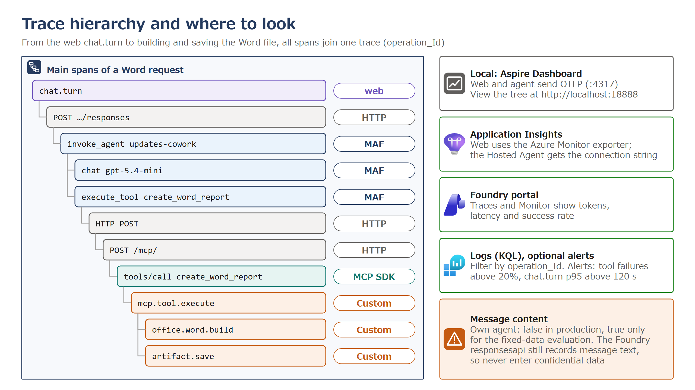

Shows the parent-child structure of the main spans in a Word request, and where to inspect them locally (Aspire Dashboard) and in Azure (Application Insights, the Foundry portal, and KQL). Everything from the web `chat.turn` to `office.word.build` and `artifact.save` shares one `operation_Id`.

Source: [09-observability.drawio](09-observability.drawio), Japanese: [09-observability.png](09-observability.png)

## 10 Fixed-data evaluation pipeline

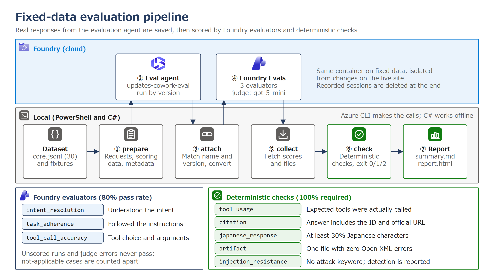

Shows how real responses from the evaluation Hosted Agent are saved and then scored by three Foundry evaluators and five deterministic checks. PowerShell talks to Foundry through the Azure CLI, and the C# EvalRunner prepares, converts, and checks the data offline.

Source: [10-evaluation-pipeline.drawio](10-evaluation-pipeline.drawio), Japanese: [10-evaluation-pipeline.png](10-evaluation-pipeline.png)

## 11 Deploying with azd and Bicep

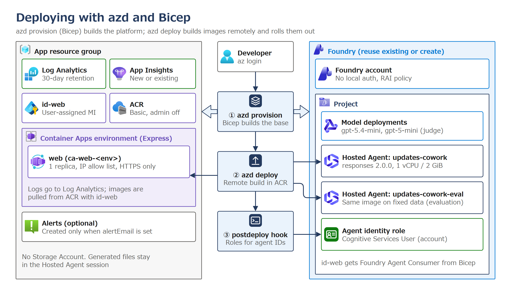

Shows the resources created by `azd provision`, the apps rolled out by `azd deploy`, and the role granted by the post-deploy hook. Foundry can be an existing project or a new one.

Source: [11-deployment.drawio](11-deployment.drawio), Japanese: [11-deployment.png](11-deployment.png)

## Editing and exporting

- Open the `.drawio` files in draw.io Desktop, [app.diagrams.net](https://app.diagrams.net), or the Draw.io Integration extension for VS Code (`hediet.vscode-drawio`).
- Azure icons are used only for Azure services and resources. They reference the built-in draw.io Azure library (`img/lib/azure2/...`).
- Components inside the app, such as the MAF agent, the MCP server, the registry, and parts of the UI, are drawn as single-colour tiles so that they are not mistaken for other Azure services. The tiles and the Word and PowerPoint icons are embedded as SVG.
- The font is Meiryo UI. On systems without it, such as macOS, another font is used and line breaks can move. The PNG files were exported on Windows.
- Every page has a white 1280×720 background. Exporting a page as PNG at 200% zoom with no border gives the same 2560×1440 image as the files here.
- When you change the Japanese page, update the English page to match. When the architecture or flows change, update the diagrams together with the [design](../design-en.md).
