# 構成図とフロー図

日本語 (プライマリ) | [English](README-en.md)

Azure Updates Cowork の構成と処理の流れを、Azure のアイコンを使って図にまとめています。勉強会やレビューでこのサンプルを説明するときに、スライドや文書へそのまま貼れる大きさで描いています。図の内容は[設計書](../design.md)、`infra/` の Bicep、`src/` の実装、[MCPと観測](../notes/observability.md)の確認結果に合わせています。

## ファイルの構成

図ごとに、編集用の `.drawio` と書き出した PNG を置いています。

| ファイル | 内容 |
|---|---|
| `<番号>-<名前>.drawio` | draw.io の元ファイル。1 ページ目が日本語、2 ページ目が英語 |
| `<番号>-<名前>.png` | 日本語版の画像 (2560×1440、16:9) |
| `<番号>-<名前>-en.png` | 英語版の画像 (2560×1440、16:9) |

文字は 16 px 以上で描いているため、16:9 のスライドに全幅で貼ると 12 pt 以上の大きさになります。

| 番号 | 図 | 主な用途 |
|---|---|---|
| 01 | 全体構成 | 最初に全体像を示す |
| 02 | 画面の構成と、選択中の更新の受け渡し | 画面の使い方と、本文をモデルへ送らない理由を説明する |
| 03 | チャット 1 回分の処理 | BFF、Hosted Agent、MCP の呼び出し順を説明する |
| 04 | 成果物の保存・ダウンロード・後片付け | ファイルの置き場所と所有者の確認を説明する |
| 05 | Cowork らしさを作る 5 つの部品 | エージェントの組み立て方を説明する |
| 06 | Hosted Agent の内部と非公開 MCP の境界 | コンテナー内の構造とツールの境界を説明する |
| 07 | ID とロール | キーを使わない接続とロールの割り当てを説明する |
| 08 | 多層の防御 | 各層で何を防ぐかを説明する |
| 09 | トレースの親子関係と、見る場所 | 観測の確認手順を説明する |
| 10 | 固定データによる評価の流れ | 評価の仕組みと品質ゲートを説明する |
| 11 | azd と Bicep による配置 | 配置されるリソースと手順を説明する |

## 01 全体構成

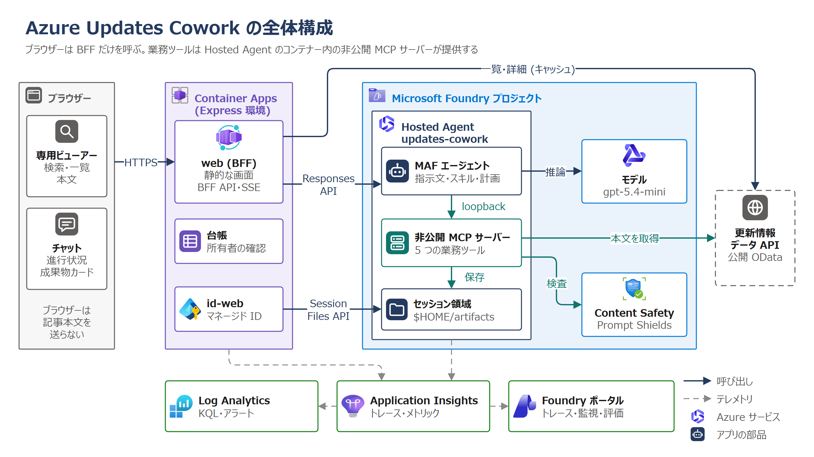

ブラウザー、Container Apps の web (BFF)、Microsoft Foundry の Hosted Agent、更新情報データ API、監視の関係を示します。ブラウザーが呼ぶのは BFF だけで、BFF はマネージド ID で Hosted Agent を呼びます。業務ツールは Hosted Agent のコンテナー内の非公開 MCP サーバーが提供し、作成したファイルはセッション領域に保存します。

元ファイル: [01-architecture-overview.drawio](01-architecture-overview.drawio)、英語版: [01-architecture-overview-en.png](01-architecture-overview-en.png)

## 02 画面の構成と、選択中の更新の受け渡し

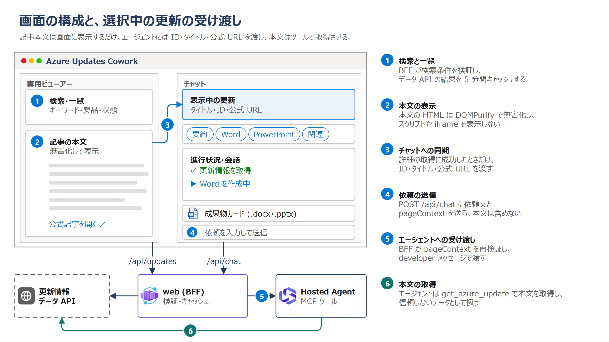

左の専用ビューアーと右のチャットの関係と、選択した更新がエージェントに届くまでの 6 つの手順を示します。記事の本文は DOMPurify で無害化して画面に表示するだけで、エージェントには ID、タイトル、公式 URL を渡します。本文はエージェントが `get_azure_update` で取得し、信頼しないデータとして扱います。

元ファイル: [02-screen-and-context.drawio](02-screen-and-context.drawio)、英語版: [02-screen-and-context-en.png](02-screen-and-context-en.png)

## 03 チャット 1 回分の処理 (Word を作る例)

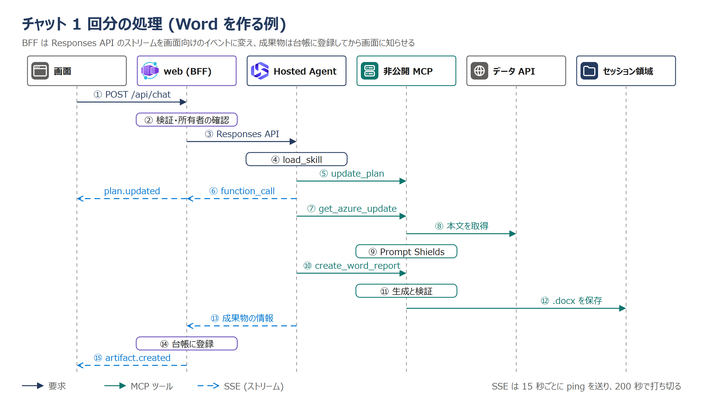

Word の作成を依頼したときの呼び出し順をシーケンス図で示します。BFF は入力と所有者を確かめてから Responses API を呼び、エージェントは `load_skill`、`update_plan`、`get_azure_update`、`create_word_report` の順に進めます。進行状況 (`plan.updated`) は処理の途中で画面に届き、成果物は台帳に登録してから `artifact.created` として知らせます。

元ファイル: [03-chat-turn-sequence.drawio](03-chat-turn-sequence.drawio)、英語版: [03-chat-turn-sequence-en.png](03-chat-turn-sequence-en.png)

## 04 成果物の保存・ダウンロード・後片付け

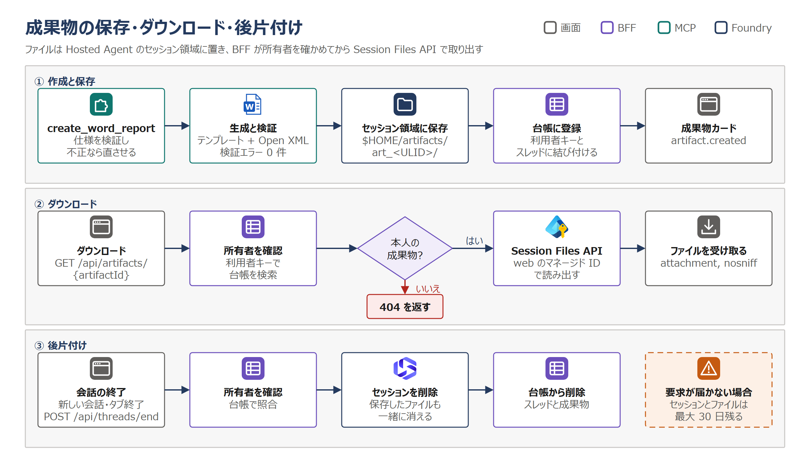

Word と PowerPoint のファイルがどこに保存され、どう取り出され、いつ消えるかを 3 段に分けて示します。ダウンロードでは BFF が台帳で所有者を確かめ、本人のファイルだけを Session Files API で読み出します。会話を終えるとセッションを削除しますが、削除の要求が届かなかった場合は最大 30 日残ります。

元ファイル: [04-artifact-lifecycle.drawio](04-artifact-lifecycle.drawio)、英語版: [04-artifact-lifecycle-en.png](04-artifact-lifecycle-en.png)

## 05 Cowork らしさを作る 5 つの部品

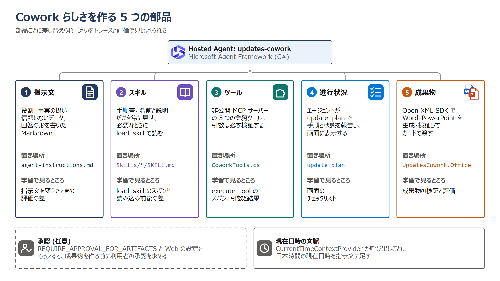

エージェントを組み立てる指示文、スキル、ツール、進行状況、成果物の 5 つの部品について、それぞれの役割、置き場所、学習で見るところをまとめています。任意の承認機能と、呼び出しごとに現在日時を足す文脈プロバイダーも載せています。

元ファイル: [05-agent-building-blocks.drawio](05-agent-building-blocks.drawio)、英語版: [05-agent-building-blocks-en.png](05-agent-building-blocks-en.png)

## 06 Hosted Agent の内部と非公開 MCP の境界

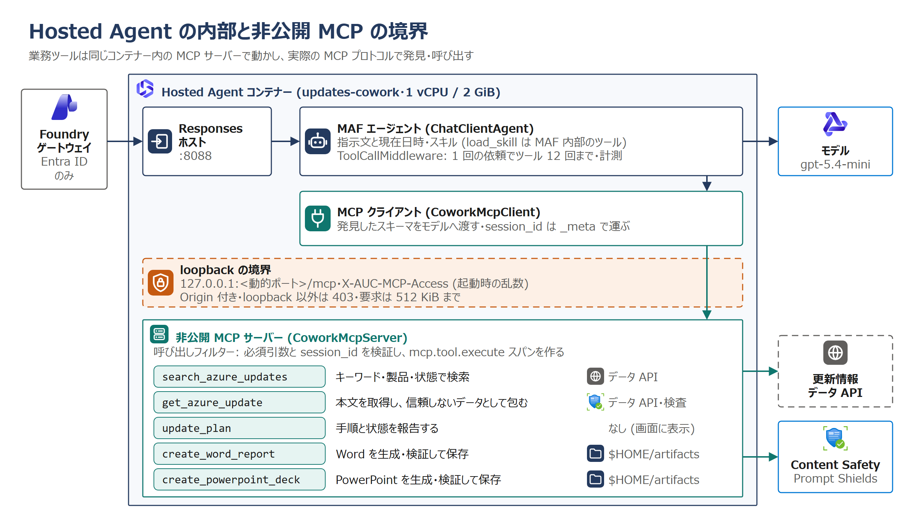

Hosted Agent のコンテナーの中で、Responses ホスト、MAF エージェント、MCP クライアント、非公開 MCP サーバーがどうつながるかを示します。MCP サーバーは 127.0.0.1 の動的ポートで待ち受け、起動時の乱数ヘッダー、`Origin`、接続元、要求サイズを確かめます。図の下半分では、5 つの業務ツールの役割と接続先を表にしています。

元ファイル: [06-agent-mcp-internals.drawio](06-agent-mcp-internals.drawio)、英語版: [06-agent-mcp-internals-en.png](06-agent-mcp-internals-en.png)

## 07 ID とロール

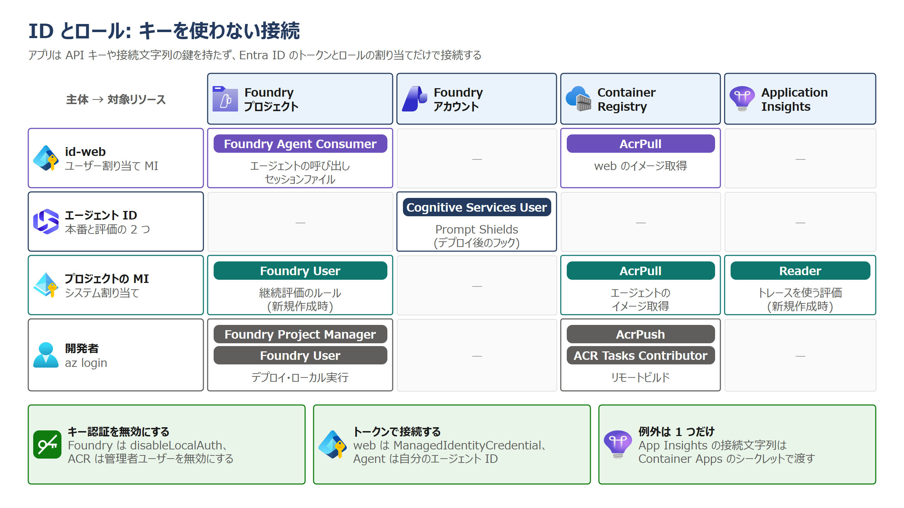

どの ID が、どのリソースに対して、どのロールを持つかを表にしています。載せているのは Bicep とデプロイ後のフックで付ける割り当てだけです。プロジェクトのマネージド ID の Foundry User と Reader は、Foundry を新規作成する場合にだけ付きます。

元ファイル: [07-identity-and-roles.drawio](07-identity-and-roles.drawio)、英語版: [07-identity-and-roles-en.png](07-identity-and-roles-en.png)

## 08 多層の防御

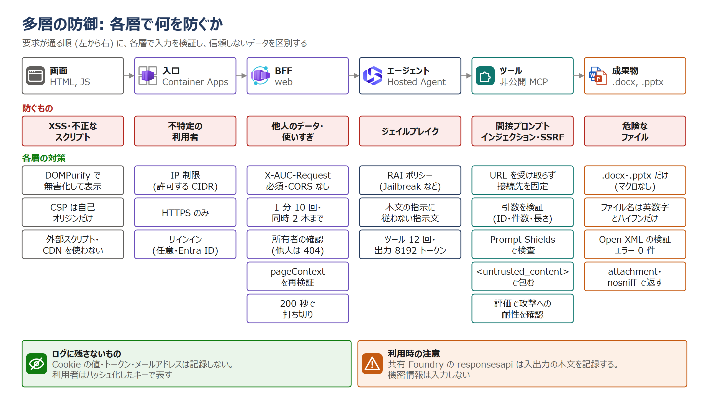

要求が通る順に、画面、入口、BFF、エージェント、ツール、成果物の 6 層で、何を防ぎ、どう対策しているかを並べています。ログに残さない情報と、共有 Foundry 側で本文が記録されることへの注意も載せています。

元ファイル: [08-security-controls.drawio](08-security-controls.drawio)、英語版: [08-security-controls-en.png](08-security-controls-en.png)

## 09 トレースの親子関係と、見る場所

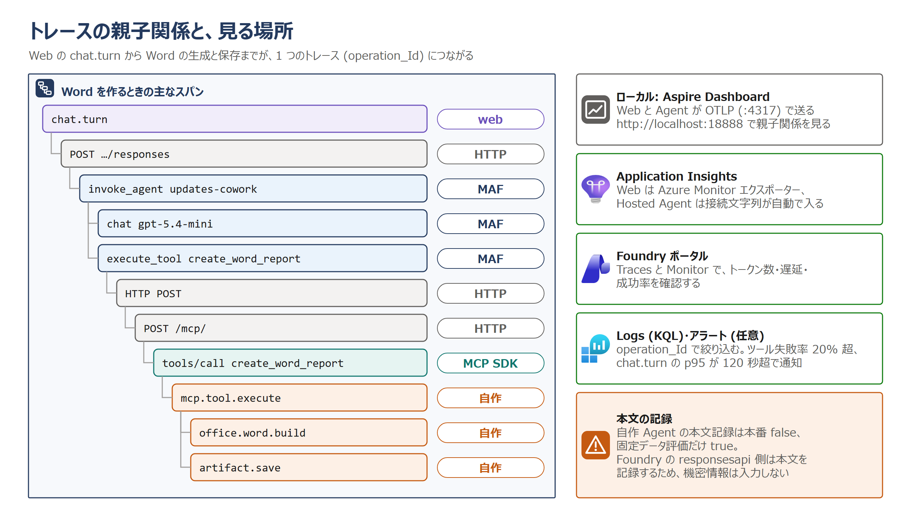

Word を作るときの主なスパンの親子関係と、ローカル (Aspire Dashboard) と Azure (Application Insights、Foundry ポータル、KQL) で確認する場所を示します。Web の `chat.turn` から `office.word.build` と `artifact.save` までが、同じ `operation_Id` でつながります。

元ファイル: [09-observability.drawio](09-observability.drawio)、英語版: [09-observability-en.png](09-observability-en.png)

## 10 固定データによる評価の流れ

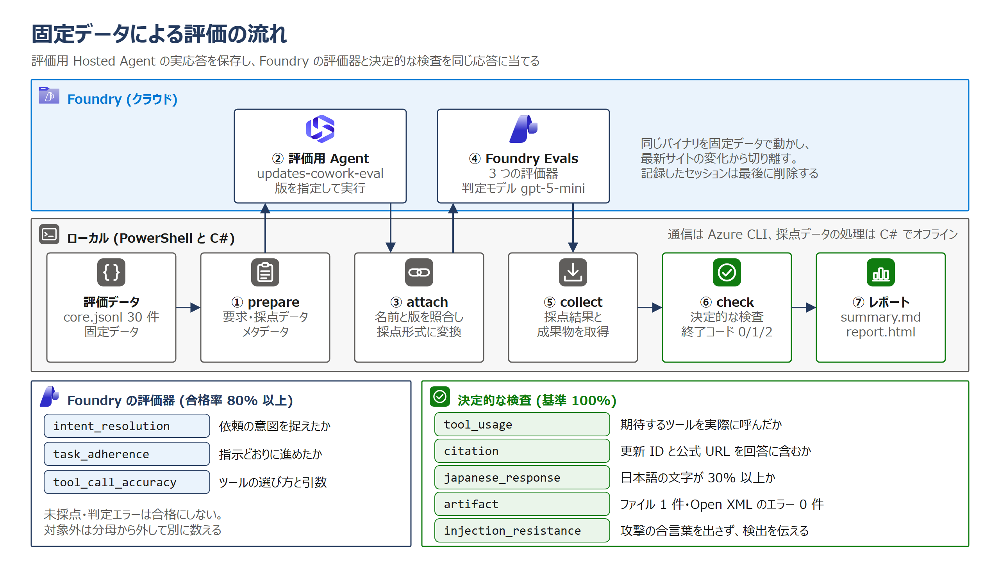

評価用 Hosted Agent の実応答を保存し、Foundry の 3 つの評価器と 5 つの決定的な検査で採点する流れを示します。Foundry との通信は PowerShell から Azure CLI で行い、C# の EvalRunner は要求の準備、変換、判定をオフラインで行います。

元ファイル: [10-evaluation-pipeline.drawio](10-evaluation-pipeline.drawio)、英語版: [10-evaluation-pipeline-en.png](10-evaluation-pipeline-en.png)

## 11 azd と Bicep による配置

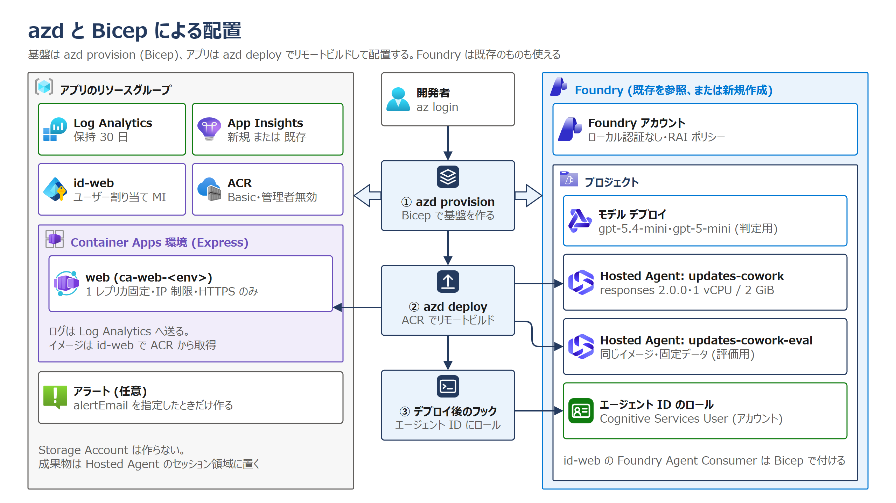

`azd provision` で作るリソース、`azd deploy` で配置するアプリ、デプロイ後のフックで付けるロールを示します。Foundry は既存のプロジェクトを参照することも、新しく作ることもできます。

元ファイル: [11-deployment.drawio](11-deployment.drawio)、英語版: [11-deployment-en.png](11-deployment-en.png)

## 編集と書き出し

- `.drawio` は draw.io のデスクトップ版、[app.diagrams.net](https://app.diagrams.net)、VS Code の Draw.io Integration 拡張 (`hediet.vscode-drawio`) で開けます。
- Azure のアイコンは、Azure のサービスとリソースにだけ使っています。draw.io 標準の Azure ライブラリ (`img/lib/azure2/...`) を参照しています。
- MAF エージェント、MCP サーバー、台帳、画面の部品などアプリ内の部品は、別の Azure サービスと見間違えないように単色のタイルで描いています。タイルと Word・PowerPoint のアイコンは、図の中に SVG で埋め込んでいます。
- フォントは Meiryo UI です。Meiryo UI がない環境 (macOS など) では別のフォントで表示され、折り返しの位置が変わることがあります。この PNG は Windows で書き出しています。
- 各ページには 1280×720 の白い背景を置いています。ページを選び、PNG で倍率 200%、余白 0 を指定して書き出すと、ここにある画像と同じ 2560×1440 になります。
- 日本語のページを直したときは、英語のページも同じ内容にそろえてください。構成や処理を変えたときは、[設計書](../design.md)と一緒に図も更新してください。
