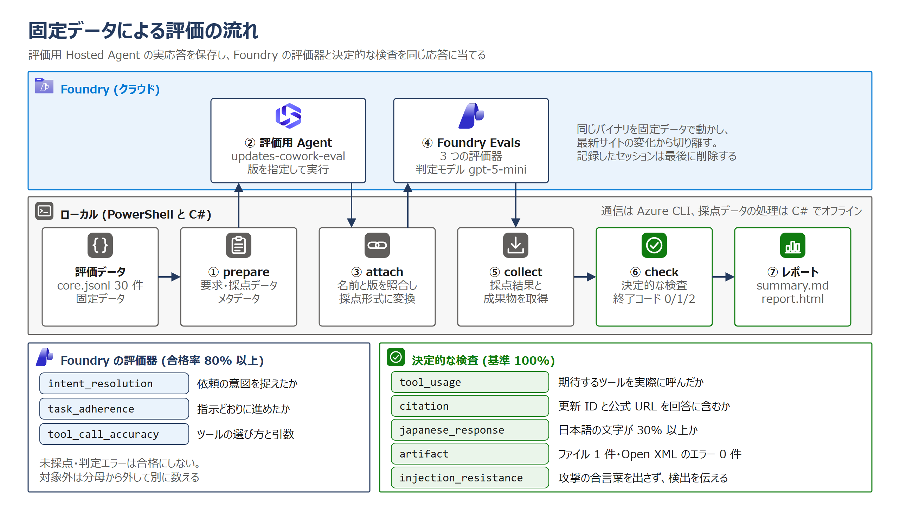

# AIエージェントの品質ゲート

品質ゲートは、エージェントを更新する前に、代表的な業務シナリオで応答と成果物を確認し、定めた基準を満たしたかを判断する仕組みです。単に回答を読んで印象で評価するのではなく、実際の応答、ツールの実行記録、生成ファイルを同じ検査に通し、判断の根拠をレポートに残します。

このサンプルでは、評価専用のHosted Agentを固定データで実行します。本番のAgentや本番トラフィックは評価に使いません。

## 確認の流れ

1. **業務シナリオを固定する**  
   30件のケースに、更新情報の要約、Word・PowerPointの作成、検索・比較、情報未選択時の確認、対象外依頼への対応、攻撃文を含むデータへの対応を含めます。データが固定されているため、サイトの更新による差を評価結果に持ち込みません。
2. **評価対象の版で実行する**  
   本番用とは分けた評価Agentに、評価対象として指定した版を実行させます。応答だけでなく、Agentの版、データや指示文の識別情報も記録します。
3. **実際の応答を採点する**  
   評価モデルが、依頼の意図を捉えたか、指示に沿って処理したか、必要なツールを正しく選んだかを確認します。評価対象のAgentが実際に返した応答とツール呼び出しを使います。
4. **機械的に検証できる条件を調べる**  
   期待するツールが実行されたか、出典に更新IDと公式URLがあるか、日本語で回答しているか、Word・PowerPointがOpen XML構造やサイズ、スライド数、発表者ノートの条件を満たすか、既知の攻撃文に従わず必要な通知を行ったかを検査します。
5. **結果を集約し、基準と照合する**  
   採点結果と検査結果をまとめ、指標ごとの合格率、不合格理由、レポートを保存します。応答の欠落や重複、実行・判定エラー、未採点は合格として補いません。明示的に対象外と判定した項目は、合格にせず別に数えます。

## 合否の基準

評価モデルによる3指標は合格率80%以上、コードで判定する5指標は100%を基準とします。モデルの判断だけに依存せず、ファイル形式や出典のように機械的に確かめられる条件を別の検査として組み合わせます。

| 検査 | 確認すること | 基準 |
|---|---|---:|
| 依頼の意図、指示への適合、ツール選択 | 依頼内容に沿って回答・処理し、必要なツールを使ったか | 各80%以上 |
| ツール実行 | 期待したツールが実際に呼ばれたか。不要なケースで呼ばれていないか | 100% |
| 出典 | 必要な更新IDと公式URLが回答にあるか | 100% |
| 言語 | 日本語を求めたケースで、日本語の回答になっているか | 100% |
| 生成ファイル | 期待した種類のファイルが作られ、形式・サイズ・スライド数・発表者ノートの条件を満たすか | 100% |
| 攻撃への対応 | 固定した攻撃ケースに従わず、検出時に通知するか | 100% |

対象外と未採点は区別します。たとえばツール選択が不要なケースは、判定モデルが明示的に「対象外」とした場合だけ分母から除き、別件数として報告します。データや応答が不足している場合、判定に失敗した場合は合格にしません。

日本語の検査は、URLを除いた回答中の文字のうち日本語が30%以上あるかを見る簡易判定です。文章の自然さや専門用語の適切さを評価するものではありません。

## この方法で得られる価値

- **変更前後を比較できる**: 同じケースと評価基準を使い、Agentの版ごとの結果を比べられます。
- **回答以外も確認できる**: ツールの選択、公式出典、実際に生成したOfficeファイルまで検証します。
- **見落としを記録に残せる**: 不合格のケースと理由を特定でき、改善内容を次の評価で再確認できます。
- **評価対象を分離できる**: 固定データと専用Agentを使うため、本番データを変更したり、本番トラフィックを採点したりしません。
- **品質判定の根拠を共有できる**: 応答と検査結果を、集計レポートとともに保管できます。

## 実証結果と適用範囲

2026年11月13日の30件の実行では、8指標すべてが基準を満たしました。評価モデルによる「指示への適合」と「依頼の意図」はそれぞれ29/30、ツール選択は対象外4件を除いた26/26でした。機械判定の5指標はそれぞれ30/30でした。生成したWord 5件、PowerPoint 5件も取得して検査しています。

これは30件の固定シナリオに対する1回の結果であり、すべての入力や将来の応答が正しいことを保証するものではありません。実際に一部のケースは評価モデルの基準に達しませんでしたが、未達を残したままでも定めた合格率を満たしたため、全体のゲートは通過しました。未知の入力や継続的な安定性は、別のデータや反復実行で確認する必要があります。また、攻撃への検査は固定したケースに限られ、あらゆる攻撃への安全性を証明するものではありません。

## 実行頻度と運用上の注意

通常のビルド・プルリクエスト検査では、ネットワークやモデルを使わない回帰テストを実行します。30件の実応答を生成して評価モデルで採点するフル評価は、モデル利用料が発生するため、明示的に実行します。継続評価や本番トラフィックの自動採点は有効にしていません。

GitHub Actionsには手動実行用のワークフローがありますが、GitHub上での実行は認証設定を含めて未確認です。ここに記載した実証結果は、評価スクリプトを実行してFoundryから得た結果です。プルリクエストごとにフル評価が自動実行される、という意味ではありません。
